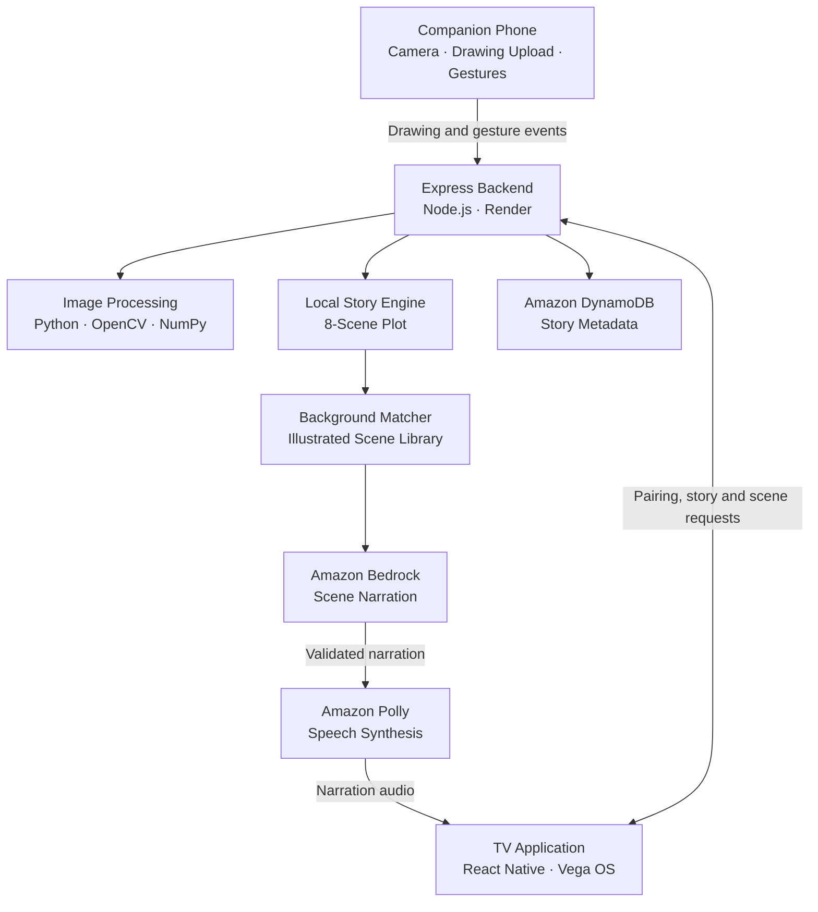

<h1 align="center">SketchTales 🎨📺</h1>

<p align="center"><strong>Every child's imagination is a world. We bring it to life.</strong></p>

<p align="center"><strong>A child draws a character. A parent scans a QR code and uploads it. SketchTales TV brings that character to life as the hero of its own narrated adventure on the big screen.</strong></p>

<p align="center">
  <a href="https://aws.amazon.com/bedrock/"></a>
  <a href="https://aws.amazon.com/polly/"></a>
  <a href="https://aws.amazon.com/dynamodb/"></a>
  <a href="https://developer.amazon.com/"></a>
  
  
  
</p>

<p align="center">
Track: <strong>Fire TV (Vega OS, React Native)</strong> · Mini Challenge: <strong>AWS Builder</strong></p>

---

## 🚀 Live Demo

| | |
|---|---|
| 🎥 **Demo video** | _Add your video link here_ |
| 📓 **Development journey** | [Friction Log](FRICTION_LOG.md) |

---

## ✨ Introducing SketchTales 

Every child carries a whole world in their head: a dragon who is afraid of the dark, a robot who loves to bake, a cat who flies to the moon. A crayon is the first way they let those ideas out.

SketchTales is how those ideas step out and start moving. A child draws a character, and it comes alive on the television, walking through magical worlds, facing a quest and being cheered on by a narrator who tells its story. There is nothing to type and no world to describe. The child's own imagination is the starting point, and the child's own character is the star.

Behind the magic, computer vision lifts the character off the page, generative AI writes the narration, and speech synthesis gives the story a voice.

<!-- Replace with a screenshot or GIF of the TV experience -->
<!--  -->

### What makes it different

- **Imagination comes alive.** The child's real drawing, with its own wobbly lines and colors, becomes the living hero of the story. Nothing is replaced by a stock character.
- **Hybrid AI design.** A deterministic story engine controls the plot. Amazon Bedrock writes the narration, grounded in the selected illustration. Output is validated, with local fallback if a request fails.
- **Two screens, one experience.** The TV shows the story while the parent's phone handles uploads and camera-based gestures.
- **Child-friendly by design.** No accounts, no typing, a parent-consent screen, and gesture events sent as text rather than video.

---

## 🎬 How it works

| Step | What happens |
|---|---|
| 1. **Pair** | The TV shows a QR code and a six-digit pairing code. |
| 2. **Upload** | A parent scans the code, accepts the consent screen and uploads a photo of the drawing. |
| 3. **Extract** | Python and OpenCV separate the character from the paper background. |
| 4. **Choose** | The child picks a story genre, such as a magical adventure. |
| 5. **Build** | A local story engine creates an eight-scene plot. A background matcher picks illustrations from the app's library. |
| 6. **Narrate with AI** | Amazon Bedrock writes short, scene-specific narration grounded in the chosen illustration. |
| 7. **Speak** | Amazon Polly generates the voice, mixed with background music using FFmpeg. |
| 8. **Interact** | The TV plays scenes, captions and the animated character. The phone sends gesture commands. |

---

## 🏗️ Architecture



### Tech stack

| Component | Technology | Responsibility |
|---|---|---|
| TV application | React Native, Vega OS | Story playback and TV interface |
| Companion interface | HTML, JavaScript, MediaPipe Tasks Vision | Drawing upload and hand tracking |
| Backend | Node.js, Express.js | API, pairing, story orchestration, gestures |
| Character processing | Python, OpenCV, NumPy | Character extraction from drawings |
| Story generation | JavaScript | Plot structure and scene selection |
| Generative AI | Amazon Bedrock (Nova 2 Lite) | Scene-specific narration |
| Text-to-speech | Amazon Polly | Spoken narration |
| Persistent storage | Amazon DynamoDB | Story metadata |
| Hosting | Render | Public backend and phone page |

---

## 🧠 Story generation: rules + AI

1. **Create the plot.** The local engine builds an eight-scene adventure from a world, quest, obstacle and ending, giving a consistent narrative.
2. **Select illustrations.** The matcher uses scene type, mood, landmarks and tags, and avoids repeating a picture within a story where possible.
3. **Generate grounded narration.** Bedrock receives the scene's plot beat and details of its illustration. It writes the narration only; it does not invent the plot or pick backgrounds.
4. **Validate.** The app checks the JSON, scene count, narration length and picture relevance. Invalid responses are retried, then fall back to local narration.
5. **Add a voice.** Polly converts narration to MP3, mixed with background music for playback.

The plot stays predictable, the narration stays expressive, and a failed AI request never breaks the story.

---

## ☁️ AWS integrations

All services are called from the Node.js backend through the AWS SDK for JavaScript v3.

| Service | Purpose | Implementation |
|---|---|---|
| **Amazon Bedrock** | Scene-specific narration via the Converse API (`@aws-sdk/client-bedrock-runtime`), with response validation and local fallback | `backend/bedrockStory.js` |
| **Amazon Polly** | MP3 narration for each scene (`@aws-sdk/client-polly`), mixed with music via FFmpeg, with fallback path | `backend/narrate.js` |
| **Amazon DynamoDB** | Lightweight story metadata: structure, picture IDs, narration source, model and Bedrock latency, with TTL expiry (`@aws-sdk/lib-dynamodb`) | `backend/awsStore.js` |

<details>
<summary><strong>Environment configuration</strong></summary>

| Variable | Purpose |
|---|---|
| `AWS_REGION` | Default AWS region |
| `BEDROCK_REGION` | Bedrock region |
| `BEDROCK_MODEL_ID` | Bedrock model or inference profile |
| `DDB_REGION` | DynamoDB region |
| `DDB_TABLE` | DynamoDB table name |
| `USE_BEDROCK` | Toggle Bedrock integration |
| `USE_DYNAMODB` | Toggle DynamoDB persistence |
| `POLLY_VOICE_ID` | Polly voice |
| `POLLY_ENGINE` | Polly speech engine |
| `POLLY_LANGUAGE_CODE` | Narration language |
| `AWS_ACCESS_KEY_ID` / `AWS_SECRET_ACCESS_KEY` | Credentials, when using access keys |

The deployed configuration uses `ap-southeast-2` (Sydney) for Bedrock and DynamoDB. Credentials are supplied via the environment and are never committed.

</details>

---

## 👋 Interactive gestures

The phone runs MediaPipe Tasks Vision in the browser and sends short gesture events to the backend. The TV also supports the standard remote.

| Gesture | Action |
|---|---|
| ✋ Open palm | Pause / resume |
| 👈 Swipe left | Next scene |
| 👉 Swipe right | Previous scene |
| 👍 Thumbs up | Restart the story |

---

## 🔒 Privacy and child-friendly design

- A parent-consent screen appears before any drawing is uploaded.
- No accounts, and no typing required from children.
- Gesture recognition runs in the phone's browser; camera video is not intentionally uploaded.
- Gestures travel as short text events, not video.
- Drawings are processed for the pairing session and are not stored in DynamoDB.
- DynamoDB holds story metadata only, never drawing images or full narration text.
- Temporary data and generated audio are subject to cleanup and expiration.

---

## 🛠️ Run locally

**Prerequisites:** Node.js 18+, Python 3 and pip, FFmpeg, an AWS account with access to the configured Bedrock model, Polly and DynamoDB, and the Amazon Vega SDK for the TV app.

```bash
# 1. Clone
git clone https://github.com/SagarishaR/SketchTalesTV.git
cd SketchTalesTV/backend

# 2. Node dependencies
npm install

# 3. Python dependencies (must be able to import cv2 and numpy)
python3 -m venv .venv
source .venv/bin/activate
python -m pip install --upgrade pip
python -m pip install -r requirements.txt

# 4. AWS configuration (use your environment or a private backend/.env)
export AWS_REGION=ap-southeast-2
export BEDROCK_REGION=ap-southeast-2
export DDB_REGION=ap-southeast-2
export DDB_TABLE=sessions
export BEDROCK_MODEL_ID=global.amazon.nova-2-lite-v1:0

# 5. FFmpeg (macOS)
brew install ffmpeg

# 6. Start the backend (default port 3000)
npm start
```

Then point the TV app's API base URL at your local backend or the deployed Render service, and build it with the official Amazon Vega workflow.

**Render deployment:** root directory `backend` · build `npm install && python3 -m pip install --no-cache-dir -r requirements.txt` · start `npm start`.

---

## 🧪 Development and feedback

Key engineering decisions:

- Deterministic plot generation combined with AI-written narration
- Narration grounded in the selected illustrations
- Validation of AI output before playback, with local fallback
- Phone-based gestures kept separate from the TV app
- Small persistent records, kept separate from image assets

The full story of what broke and how it was fixed is in the [Friction Log](FRICTION_LOG.md).

---

## 🎨 Credits

- **Background illustrations:** AI-assisted image generation, in a children's-storybook style
- **Hand tracking:** MediaPipe Tasks Vision
- **Cloud AI and speech:** Amazon Bedrock and Amazon Polly
- **Metadata storage:** Amazon DynamoDB
- **Backend hosting:** Render
- **Development assistance:** AI tools were used during implementation and debugging

## 📄 License

Released under the MIT License. See [LICENSE](LICENSE).
